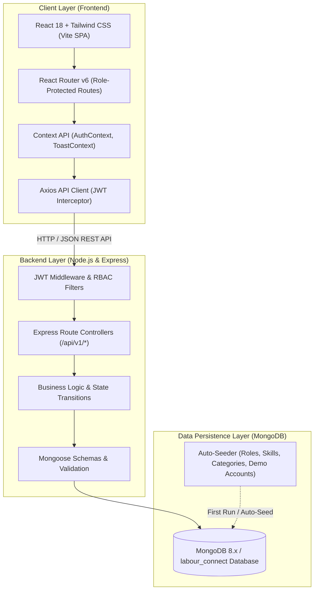

# Labour Connect — Digital Platform for Skilled Employment and On-Demand Local Services
> **Student:** Prince Bansal | **PRN:** 202401100064 | **Course:** Web Technology (WT)  
> **Live Web Application:** [https://labour-connect-updated.vercel.app/](https://labour-connect-updated.vercel.app/)  
> **Live Backend API:** [https://labour-connect-updated.onrender.com/api/v1](https://labour-connect-updated.onrender.com/api/v1)  
> **GitHub Repository:** [https://github.com/umangramteke/labour-connect-updated](https://github.com/umangramteke/labour-connect-updated)  

Labour Connect is a full-stack web application designed to connect daily-wage and regular skilled workers, employers/shopkeepers, local customers, and verified on-demand service providers within communities.

---

## 1. System Architecture

The project is structured as a clean, modular full-stack application with a **React 18 frontend**, a **Node.js & Express REST API backend**, and a **MongoDB document database**:

```
LabourConnectProject/
├── backend/                  # Node.js + Express REST API + MongoDB (Mongoose)
│   ├── src/
│   │   ├── config/           # MongoDB connection & seed runner
│   │   ├── controllers/      # REST API Controllers (/api/v1/*)
│   │   ├── middleware/       # JWT Authentication, RBAC, Error Handler
│   │   ├── models/           # Mongoose Data Models & Schemas
│   │   ├── routes/           # Express Route definitions
│   │   ├── utils/            # ApiResponse envelope, pagination, haversine
│   │   └── server.js         # Express app entry point
│   ├── tests/                # Automated API test suite
│   ├── package.json          # Backend dependencies & npm scripts
│   ├── .env                  # Environment configuration
│   └── .env.example          # Environment template
├── frontend/                 # React 18 + Vite + Tailwind CSS SPA
│   ├── src/
│   │   ├── components/       # Reusable UI components (Navbar, Modal, Button, etc.)
│   │   ├── context/          # AuthContext (JWT) and ToastContext (alerts)
│   │   ├── features/         # Domain feature modules (admin, employers, workers, etc.)
│   │   ├── layouts/          # MainLayout (public) and DashboardLayout (sidebar)
│   │   ├── pages/            # Public pages (Home, Login, Register, Terms, Privacy)
│   │   ├── routes/           # AppRoutes and ProtectedRoute (RBAC)
│   │   ├── services/         # Axios client with JWT interceptor
│   │   ├── styles/           # Tailwind CSS base styles
│   │   └── utils/            # Constants, formats, and badges
│   ├── index.html            # HTML entry point
│   ├── package.json          # Frontend dependencies and npm scripts
│   ├── vite.config.js        # Vite bundler configuration
│   └── .env                  # Frontend API base URL & Google Client ID
├── database/                 # MongoDB initialization & collection export scripts
│   ├── setup-mongodb.ps1     # Automated MongoDB setup & seed script
│   ├── backup-mongodb.ps1    # Automated MongoDB export script (JSON)
│   ├── restore-mongodb.ps1   # Automated MongoDB restore script (JSON)
│   ├── export-mongo.js       # Node-based collection exporter
│   ├── import-mongo.js       # Node-based collection importer
│   └── backups/              # Exported collection snapshots
├── backend-spring/           # Archived Java Spring Boot backend (for reference)
├── .gitignore                # Standard Git ignore rules
└── README.md                 # Complete project documentation & guide
```

### Architectural Data Flow



---

## 2. Core Modules & User Roles

Labour Connect operates through two main modules:

### A. Employment Connect
1. **Daily Wage Employment**: Hiring skilled labor (masons, carpenters, painters, helpers) on daily rates.
2. **Contract Employment**: Project-based hiring for specific milestones and budgets.
3. **Regular Employment**: Long-term regular hiring for retail salesmen, shop assistants, cashiers, office assistants, and general helpers with monthly salary ranges (`₹/month`) and defined working hours.

### B. On-Demand Service Connect
- Connects local households and businesses with verified professionals for on-demand services:
  - **Plumbing**, **Electrical**, **Carpentry**, **House Painting**, **Cleaning**, **Appliance Repair**.
  - Service request lifecycle: `REQUESTED` → `ACCEPTED` → `ON_THE_WAY` → `SERVICE_STARTED` → `COMPLETED`.

---

### The Five User Roles
| Role | Authority | Key Capabilities |
| :--- | :--- | :--- |
| **Admin** | `ROLE_ADMIN` | Platform governance, provider verification approval/rejection, service catalog management, dispute resolution, security audit logs. |
| **Employer** | `ROLE_EMPLOYER` | Post daily wage, contract, or regular jobs; review applicant bids; shortlist, hire, or reject workers; rate worker performance. |
| **Worker** | `ROLE_WORKER` | Manage profile and skills; browse jobs with filters; submit applications/bids; track application progress. |
| **Customer** | `ROLE_CUSTOMER` | Browse verified service providers; book on-demand service requests; track live status; rate providers; raise complaints. |
| **Service Provider** | `ROLE_PROVIDER` | Manage service categories and pricing; receive customer requests; progress request statuses; submit credentials for verified badge. |

---

## 3. Technology Stack

- **Frontend**: React 18, Vite 5, Tailwind CSS 3.4, React Router v6, Axios, Lucide Icons, Google Identity Services OAuth 2.0.
- **Backend**: Node.js v20+, Express 4.x, MongoDB, Mongoose 8.x, JWT (`jsonwebtoken`), Password Hashing (`bcryptjs`), Security (`helmet`, `cors`).
- **Database**: MongoDB 8.x on `mongodb://127.0.0.1:27017/labour_connect`.
- **Testing**: Node Test Runner + Supertest integration suite (10 automated test suites).

---

## 4. Local Setup & Running Instructions

### Step 1: Ensure MongoDB is Running
Make sure MongoDB is running locally on port 27017 (default).
To verify with mongosh:
```powershell
mongosh --eval "db.runCommand({ ping: 1 })"
```

### Step 2: Start the Backend (Node.js + Express + MongoDB)
In a terminal:
```powershell
cd backend
npm install
npm start
```
*The backend connects to MongoDB, automatically seeds all demo accounts, skills, categories, jobs, applications, and service requests on startup, and listens on port 8081.*

The backend REST API will be available at: **`http://localhost:8081/api/v1`**  
Health Check: **`http://localhost:8081/api/v1/health`**

### Step 3: Start the Frontend (React + Vite)
In a separate terminal:
```powershell
cd frontend
npm install
npm run dev
```
Open **[http://localhost:5173](http://localhost:5173)** in your browser.

---

## 5. Pre-Configured Demo Accounts

The database includes pre-seeded verified test accounts for each role:

| Role | Email Address | Password | Description |
| :--- | :--- | :--- | :--- |
| **System Admin** | `admin@labourconnect.com` | `Admin@1234` | Governance, dispute resolution, provider verification |
| **Employer** | `employer@labourconnect.com` | `Employer@1234` | Apex Construction & Hardware Stores (active jobs) |
| **Skilled Worker** | `worker@labourconnect.com` | `Worker@1234` | Suresh Sharma (Masonry, General Labour) |
| **Customer** | `customer@labourconnect.com` | `Customer@1234` | Anita Sharma (Residential homeowner) |
| **Service Provider** | `provider@labourconnect.com` | `Provider@1234` | Ramesh Electrician (Verified Badge) |

---

## 6. REST API Reference Overview

Base URL: `http://localhost:8081/api/v1`

| Category | Method | Endpoint | Description | Role Required |
| :--- | :--- | :--- | :--- | :--- |
| **Auth** | `POST` | `/auth/register` | Register new user account | Public |
| | `POST` | `/auth/login` | Authenticate; returns JWT access token | Public |
| | `POST` | `/auth/google` | Google OAuth 2.0 Sign-In / Sign-Up | Public |
| | `GET` | `/auth/me` | Fetch authenticated user details | Authenticated |
| | `POST` | `/auth/logout` | Terminate session | Authenticated |
| **Profiles** | `GET/PUT` | `/profiles/worker` | Worker headline, skills, wage rates | `ROLE_WORKER` |
| | `GET/PUT` | `/profiles/employer` | Employer company, contact info | `ROLE_EMPLOYER` |
| | `GET/PUT` | `/profiles/provider` | Provider categories, pricing, radius | `ROLE_PROVIDER` |
| | `GET/PUT` | `/profiles/customer` | Customer address and location | `ROLE_CUSTOMER` |
| **Jobs** | `GET` | `/jobs` | Search & filter jobs (`jobType`, `query`, `city`, `minWage`) | Public |
| | `GET` | `/jobs/{id}` | View detailed job posting | Public |
| | `POST` | `/jobs` | Post new job (Daily Wage, Contract, Regular) | `ROLE_EMPLOYER` |
| | `PUT` | `/jobs/{id}` | Update job details | `ROLE_EMPLOYER` (Owner) |
| | `DELETE` | `/jobs/{id}` | Close or cancel job | `ROLE_EMPLOYER` (Owner) |
| | `GET` | `/jobs/my-jobs` | Employer's posted jobs | `ROLE_EMPLOYER` |
| | `GET` | `/jobs/{id}/applications` | View applicants for a job | `ROLE_EMPLOYER` (Owner) |
| | `POST` | `/jobs/{id}/apply` | Apply for a job | `ROLE_WORKER` |
| | `GET` | `/jobs/applications/my-applications` | Worker's application history | `ROLE_WORKER` |
| | `PUT` | `/jobs/applications/{id}/status` | Accept, shortlist, or reject applicant | `ROLE_EMPLOYER` (Owner) |
| | `POST` | `/jobs/applications/{id}/withdraw` | Worker withdraws application | `ROLE_WORKER` |
| **Services** | `GET` | `/categories` | List active service categories | Public |
| | `GET` | `/services/providers` | Discover nearby service providers | Public |
| | `POST` | `/requests` | Book an on-demand service | `ROLE_CUSTOMER` |
| | `GET` | `/requests/my-requests` | Customer's bookings history | `ROLE_CUSTOMER` |
| | `GET` | `/requests/provider-requests` | Provider's incoming service jobs | `ROLE_PROVIDER` |
| | `PUT` | `/requests/{id}/status` | Transition service request status | Assigned Provider |
| | `POST` | `/requests/{id}/cancel` | Cancel booking | Customer |
| **Trust** | `POST` | `/reviews` | Submit star rating and feedback | Authenticated |
| | `GET` | `/reviews/user/{userId}` | Get reviews for a worker/provider/user | Public |
| | `POST` | `/complaints` | Submit formal dispute complaint | Authenticated |
| | `GET` | `/complaints/my` | View submitted complaints | Authenticated |
| **Admin** | `GET` | `/admin/stats` | Platform metrics & statistics | `ROLE_ADMIN` |
| | `GET` | `/admin/users` | Manage user activation/suspension | `ROLE_ADMIN` |
| | `PUT` | `/admin/users/{id}/status` | Suspend or reactivate user account | `ROLE_ADMIN` |
| | `GET` | `/admin/verifications` | Review provider verification requests | `ROLE_ADMIN` |
| | `PUT` | `/admin/verifications/{id}` | Approve / reject provider verification | `ROLE_ADMIN` |
| | `GET` | `/admin/complaints` | Dispute mediation list | `ROLE_ADMIN` |
| | `PUT` | `/admin/complaints/{id}` | Resolve dispute complaint | `ROLE_ADMIN` |
| | `GET` | `/admin/audit-logs` | Security and governance audit trail | `ROLE_ADMIN` |

---

## 7. Automated Tests & Build Verification

### Backend Automated Test Suite
```powershell
cd backend
npm test
```
*Runs comprehensive integration test suites with 10 test cases covering health check, authentication, job posting, regular employment validation, on-demand dispatch lifecycles, and reviews (10 tests pass, 0 failures, 0 errors).*

### Frontend Production Build Verification
```powershell
cd frontend
npm run build
```
*Validates zero JSX/syntax errors, Tailwind tree-shaking, and builds production static bundle in `frontend/dist/` (1,672 modules transformed, 0 errors).*

---

## 8. Database Backup and Recovery

Automated scripts for MongoDB are located under `database/`:
```powershell
# Initialize and seed MongoDB
.\database\setup-mongodb.ps1

# Create a JSON backup snapshot of all MongoDB collections
.\database\backup-mongodb.ps1

# Restore from a backup snapshot folder
.\database\restore-mongodb.ps1 -BackupFolder ".\database\backups\backup_YYYY-MM-DD..."
```
